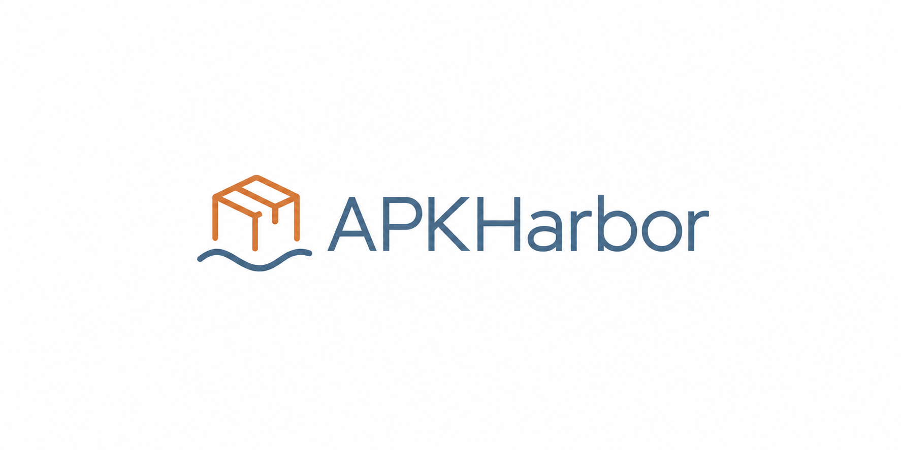

<p align="center">
  
</p>

# APKHarbor

Search Google Play, download Android app packages, and install compatible APK sets with ADB.

APKHarbor is an experimental Python CLI with a simple Mac menu launcher. Use your own Google Play account and keep base APKs, split APKs, and download manifests together.

**Version 0.3.0 · Python 3.9+ · MIT license · No third-party Python runtime dependencies**

> Google Play access uses an unofficial protocol. Direct login requires a manual one-time browser token, and compatibility can change. This project is independent of Google and Android.

## Features

- Search apps by name and inspect package metadata.
- Download base APKs, device-specific splits, and additional files returned by Play.
- Record file sizes and SHA-256 hashes; verify upstream hashes when supplied.
- Install manifest-listed APKs using an explicitly selected ADB executable.
- Choose a CLI workflow or the numbered Mac menu.
- Authenticate directly with Google without requiring a third-party token server.

## Quick start

For the easiest Mac setup and GitHub upload steps, read [START HERE.txt](START%20HERE.txt).

Download or clone the repository, open Terminal in its root folder, and run:

```bash
python3 -m venv .venv
source .venv/bin/activate
python -m pip install .
apkharbor --version
```

You can also run from source without installing the package:

```bash
python3 -m apkharbor --help
```

The CLI targets macOS, Linux, and Windows. Development checks primarily run on macOS; native Windows and physical-device coverage remain limited. On Windows, virtual-environment executables are in `.venv\Scripts`.

## Sign in

```bash
apkharbor auth login --email you@example.com
```

APKHarbor opens Google's [EmbeddedSetup page](https://accounts.google.com/EmbeddedSetup). Enter your password and complete two-factor authentication on Google's website.

1. In Chrome, open Developer Tools, select **Network**, enable **Preserve log**, and reload the Google page before completing sign-in.
2. After sign-in, inspect a recent `accounts.google.com` request's response cookies for `oauth_token`.
3. Copy its value, beginning with `oauth2_4/`, into APKHarbor's **hidden Terminal prompt** and press Enter.

The token is exchanged directly with Google. The one-time browser token and resulting long-lived account token are not saved; a Play session is stored locally. Repeat login when that session expires.

**Keep tokens private. Never include them in issues, screenshots, chat messages, or shell commands.** If Google does not issue the cookie or rejects authentication, this flow cannot complete. APKHarbor does not silently switch to a token server or accept Play terms automatically.

See [advanced usage and authentication](docs/ADVANCED_USAGE.md) for detailed instructions, session import, device profiles, and optional explicit server pairing.

## Search and download

```bash
apkharbor search "VLC" --limit 5
apkharbor info org.videolan.vlc --json
apkharbor download org.videolan.vlc --output ./downloads
```

The default Android target is ARM64, regardless of your computer's processor. Other targets require a matching authenticated device profile.

Completed downloads are organized as:

```text
downloads/<package>/<version-code>/<arch>/package/
├── base.apk
├── split-<name>.apk
└── manifest.json
```

Keep the entire package folder together. Apps may also include OBB or asset files. Downloads are staged before publication, and existing completed downloads are preserved.

## Install on Android

Install Android SDK Platform-Tools, enable USB debugging on your phone, and authorize the connection. Use the manifest path printed after downloading:

```bash
apkharbor install /absolute/path/to/manifest.json \
  --adb /absolute/path/to/platform-tools/adb \
  --serial YOUR_DEVICE_SERIAL
```

`--adb` must select a trusted **absolute executable path**. APKHarbor does not search the current directory or PATH for ADB. Omit `--serial` when only one eligible device is connected.

Automatic installation supports base and split APKs. OBB and asset files require separate installation handling.

## Mac menu launcher

Unzip this project and open **Start APKHarbor.command** in its root folder. You can also run `python3 menu.py` from that folder. It uses an existing Python 3.9+ installation without pip setup.

The menu provides Google login, app search, numbered download selection, local session status, and a shortcut to Downloads. The included **START HERE.txt** explains setup and the manual browser-token step. APKs are Android applications and do not run as Mac applications.

## Credentials and integrity

Sessions use `~/.config/apkharbor` by default. Set `APKHARBOR_CONFIG_DIR` to override this location. Existing installations can reuse their earlier Droidtool configuration; see the advanced guide.

On POSIX systems, credentials use owner-only files and directories. **They are plaintext, not encrypted at rest.** Windows users must protect the directory with appropriate ACLs.

```bash
apkharbor auth status
apkharbor auth logout
```

Status checks local presence, not whether Google still accepts the session. Logout removes local credentials for the selected architecture. Explicit server pairing requires separate server-side revocation.

Manifest hashes detect later file changes; they do not authenticate the APK publisher or replace signing-certificate verification. Download redirects between permitted Google HTTPS domains discard credentials when the host changes. API and authentication redirects remain restricted to the same origin.

## Limitations

- Google can change or reject the unofficial authentication and download protocol.
- Availability depends on account entitlement, region, Android version, and device compatibility.
- Historical versions work only when Play still serves them to the selected account and device.
- The tool does not perform paid-app checkout or bypass entitlement checks.
- Incomplete transfers are not resumed automatically; universal-APK merging is not implemented.
- Automated tests mock network responses and ADB. Broader live-account and device validation is ongoing.

Use APKHarbor for apps you are entitled to access, following applicable store terms and app licenses.

## Development

```bash
python3 -m unittest discover -s tests -v
```

Tests cover authentication failures, token non-persistence, credential permissions, downloads, redirects, manifest integrity, explicit ADB selection, and configuration compatibility.

## Roadmap

- Broader live-account and device compatibility checks.
- OS credential-store integration and download resource limits.
- Download resume and Android device discovery.
- Optional Aurora anonymous authentication in a future major version.

## Contributing

Bug reports and focused pull requests are welcome. Include your OS, Python version, APKHarbor version, reproduction steps, and a redacted error message. Never include credentials, cookies, signed download URLs, or private session files.

## Credits and license

The protocol parser and related components build on MIT-licensed [gplaydl](https://github.com/rehmatworks/gplaydl). Direct authentication draws on interoperability work documented by [apkeep](https://github.com/EFForg/apkeep), [rs-google-play](https://github.com/EFForg/rs-google-play), and [gpsoauth](https://github.com/simon-weber/gpsoauth).

See [THIRD_PARTY.md](THIRD_PARTY.md) for attribution and [LICENSE](LICENSE) for the MIT license.

APKHarbor has not been published to a package registry. These installation instructions use the local repository.
